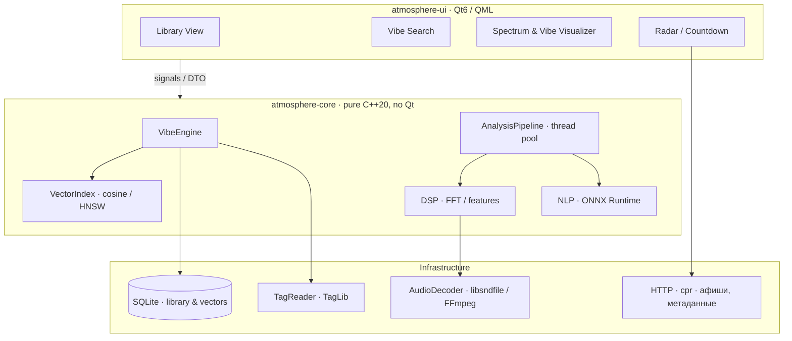

<div align="center">

# 🌌 Atmosphere Engine

**Десктопное приложение, которое слышит атмосферу, а не жанры.**

[](https://github.com/yourusername/atmosphere-engine/actions)
[](https://isocpp.org/)
[](https://cmake.org/)
[](https://www.qt.io/)
[](#-сборка)
[](LICENSE)

<!-- TODO: заменить на реальный скриншот/GIF интерфейса -->


</div>

---

**Atmosphere Engine** анализирует твою локальную музыкальную библиотеку и оценивает треки не по жанровым тегам, а по **плотности атмосферы, эмоциональному окрасу и смысловой нагрузке текста**. Всё считается на твоей машине: ни облаков, ни аккаунтов, ни телеметрии.

Сделано для музыки, которую слушают внимательно — вроде 3umph, tewiq, Поларойд и всей андеграунд-сцены, где вайб важнее чартов.

## ✨ Возможности

- 🎛 **Локальный DSP-анализ аудио.** Декодирование FLAC/MP3/WAV, FFT, spectral centroid / rolloff / flatness, RMS-энергия, динамический диапазон, оценка темпа. Именно из этого собирается «плотность атмосферы» — без обращений к чужим API.
- 🧠 **NLP-разбор текстов.** Мультиязычные эмбеддинги через ONNX Runtime локально: рефлексия, меланхолия, социальный подтекст. Модель весит десятки мегабайт и работает на CPU.
- 🎯 **Поиск по вайбу.** Задаёшь вектор (`melancholy 0.8 / atmosphere 0.9 / energy 0.3`) — получаешь треки из своей библиотеки, отсортированные по косинусной близости.
- 📚 **Умная библиотека.** Сканирование папок, чтение тегов, инкрементальное переиндексирование, умные плейлисты и экспорт в `.m3u`.
- 📡 **Concert Radar.** Отслеживание концертов отслеживаемых артистов по открытым афишам + системные уведомления.
- ⏳ **Countdown-виджет.** Обратный отсчёт до первого московского концерта 3umph в 2027-м, который меняет оформление в зависимости от «атмосферы» дня.
- 🔒 **Offline-first.** Аудио и тексты не покидают машину. Сеть используется только для афиш и (опционально) метаданных — и это отключается в настройках.

## 🏗 Архитектура

Ключевое решение: **`core` не зависит от Qt**. Это статическая библиотека на чистом C++20, которую можно собрать, протестировать и бенчмаркать отдельно от UI.



**Как считается анализ:** файл попадает в очередь → пул воркеров декодирует его в PCM → DSP-фичи и NLP-эмбеддинг текста считаются параллельно → результат сводится в `VibeVector` → пишется в SQLite и обновляет векторный индекс. UI получает прогресс через сигналы и никогда не блокируется.

## 🛠 Стек

| Слой | Технология |
| :--- | :--- |
| **Язык** | C++20 (concepts, ranges, `std::expected`-style error handling) |
| **UI** | Qt 6 / QML, кастомная тёмная тема |
| **DSP** | kissfft, libsndfile / FFmpeg |
| **ML** | ONNX Runtime (CPU), опционально llama.cpp для саммари |
| **Хранилище** | SQLite (SQLiteCpp), собственный векторный индекс |
| **Метаданные / сеть** | TagLib, cpr, nlohmann/json |
| **Сборка** | CMake 3.24+, CMakePresets, vcpkg manifest |
| **Тесты** | GoogleTest + Google Benchmark |
| **Качество** | clang-format, clang-tidy, cppcheck, ASan/UBSan |
| **CI/CD** | GitHub Actions (matrix: Linux / Windows / macOS) |

## 🔨 Сборка

### Зависимости

Компилятор с C++20 (GCC 12+, Clang 15+, MSVC 2022+), CMake 3.24+, Qt 6.5+. Остальное подтянется через vcpkg.

### Linux / macOS

```bash
git clone https://github.com/yourusername/atmosphere-engine.git
cd atmosphere-engine

cmake --preset release        # конфигурация + установка зависимостей vcpkg
cmake --build --preset release -j

./build/release/bin/atmosphere
```

### Windows

```powershell
cmake --preset msvc-release
cmake --build --preset msvc-release
.\build\msvc-release\bin\Release\atmosphere.exe
```

### Полезные флаги CMake

| Флаг | По умолчанию | Описание |
| :--- | :--- | :--- |
| `ATMOSPHERE_BUILD_TESTS` | `ON` | Сборка тестов и бенчмарков |
| `ATMOSPHERE_ENABLE_SANITIZERS` | `OFF` | ASan + UBSan (Debug) |
| `ATMOSPHERE_ENABLE_LLM` | `OFF` | Текстовые саммари через llama.cpp |
| `ATMOSPHERE_USE_SYSTEM_QT` | `ON` | Использовать системный Qt вместо vcpkg |

## 📦 Установка

Готовые сборки — на странице [Releases](https://github.com/yourusername/atmosphere-engine/releases):

- **Linux** — AppImage (`chmod +x` и запуск)
- **Windows** — установщик `.exe` / portable-архив
- **macOS** — `.dmg` (universal: arm64 + x86_64)

## ⌨️ Использование

1. **Добавь библиотеку** — `Ctrl+O`, выбери папку с музыкой.
2. **Дождись анализа** — прогресс в статус-баре, можно ставить на паузу и продолжать.
3. **Ищи по вайбу** — `Ctrl+K`, двигай слайдеры атмосферы/меланхолии/энергии.
4. **Смотри разбор трека** — спектр, вектор вайба, разобранный текст.

| Shortcut | Действие |
| :--- | :--- |
| `Ctrl+O` | Добавить папку |
| `Ctrl+K` | Поиск по вайбу |
| `Ctrl+R` | Переиндексировать библиотеку |
| `Space` | Play / Pause |
| `Ctrl+,` | Настройки |

Бонусом есть headless-режим для скриптов и замеров:

```bash
atmosphere --analyze ~/Music/track.flac --json
```

```json
{
  "track": "track.flac",
  "duration_ms": 214000,
  "vibe_vector": {
    "melancholy": 0.85,
    "reflection": 0.92,
    "social_subtext": 0.40,
    "atmosphere_density": 0.88,
    "energy": 0.31
  },
  "audio_features": {
    "bpm": 78.4,
    "spectral_centroid_hz": 1420.7,
    "dynamic_range_db": 7.2
  }
}
```

## ⚡ Производительность

Анализ — самая горячая часть, поэтому она покрыта бенчмарками (`google-benchmark`).

<!-- TODO: заполнить реальными цифрами после замеров -->
| Операция | Время | Условия |
| :--- | :--- | :--- |
| Декодирование + DSP, трек 3 мин | `—` мс | Ryzen 5 / 1 поток |
| NLP-инференс текста | `—` мс | CPU, ONNX, int8 |
| Поиск по 10 000 треков | `—` мс | top-50, flat cosine |

```bash
cmake --build --preset release --target bench
```

## 📁 Структура проекта

```
atmosphere-engine/
├── CMakeLists.txt
├── CMakePresets.json
├── vcpkg.json
├── src/
│   ├── core/            # чистый C++20, без Qt
│   │   ├── dsp/         # FFT, извлечение фич
│   │   ├── nlp/         # ONNX-инференс, токенизация
│   │   ├── index/       # векторный поиск
│   │   ├── model/       # Track, VibeVector, Event
│   │   └── pipeline/    # очередь задач, thread pool
│   ├── ui/              # Qt6 / QML
│   └── app/             # точка входа, DI, конфиг
├── tests/               # GoogleTest
├── bench/               # Google Benchmark
├── resources/           # QML, иконки, темы, модели
├── packaging/           # AppImage, NSIS, dmg
└── docs/                # скриншоты, ADR, схема архитектуры
```

## 🗺 Roadmap

- [ ] DSP-пайплайн: декодирование, FFT, базовые фичи
- [ ] SQLite-хранилище и сканер библиотеки
- [ ] ONNX-инференс текстов, сборка `VibeVector`
- [ ] Векторный индекс и поиск по вайбу
- [ ] Тёмный QML-интерфейс + визуализатор спектра
- [ ] Concert Radar и системные уведомления
- [ ] Countdown-виджет до концерта 3umph (Москва, 2027) 🎟️
- [ ] Пакетирование: AppImage / NSIS / dmg
- [ ] Опциональная интеграция со Spotify API (импорт плейлистов)

## 🧪 Тесты и качество

```bash
ctest --preset release --output-on-failure
```

CI на каждый PR проверяет:
1. `clang-format` — единый стиль;
2. `clang-tidy` + `cppcheck` — статический анализ;
3. Сборку на GCC / Clang / MSVC в Debug и Release;
4. Тесты под ASan + UBSan;
5. Сборку пакетов для трёх платформ на тегах.

## 📄 Лицензия

Проект распространяется под **GNU General Public License v3.0**.

- ✅ Можно использовать, изучать, модифицировать и распространять, в том числе коммерчески.
- ⚠️ При распространении бинарников (включая производные работы) необходимо предоставить исходный код под той же GPL-3.0.
- ℹ️ Личное использование и модификация «для себя» никаких обязательств не создают.

Полный текст — в файле [LICENSE](LICENSE).

**Совместимость зависимостей:** Qt 6 используется на условиях LGPLv3, ONNX Runtime, kissfft, nlohmann/json, cpr — MIT/BSD, всё совместимо с GPL-3.0. При сборке с FFmpeg используется GPL-конфигурация (`--enable-gpl`), что учитывается в упакованных сборках.

## 🤝 Contributing

PR приветствуются. Для крупных изменений сначала открой issue — обсудим дизайн.

- стиль — `.clang-format`, статический анализ — `.clang-tidy`;
- новая логика в `core` обязательно с тестами;
- коммиты — [Conventional Commits](https://www.conventionalcommits.org/);
- внося вклад, ты соглашаешься на распространение своего кода под GPL-3.0.

## ⚖️ Дисклеймер

Приложение не связано с артистами и правообладателями. Тексты и метаданные запрашиваются только из открытых источников и в объёме, допустимом их условиями использования; аудиофайлы обрабатываются локально и никуда не передаются.

---

<div align="center">
<sub>Слушай внимательно. 🌌</sub>
</div>
